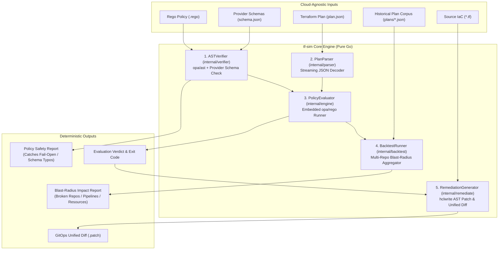

# `tf-sim`: Cloud-Agnostic Policy Verification, Blast-Radius Simulation & GitOps Remediation Engine

**Status:** Approved POC Blueprint  
**Architecture Paradigm:** Deterministic Compilation, Streaming Plan Evaluation, Historical Backtesting, and Surgical HCL AST Remediation  
**Target Runtime:** Pure Go (`CGO_ENABLED=0`) Single Binary CLI & Control Plane Engine

---

## 1. Executive Summary & Core Thesis

Enterprise security and platform engineering teams suffer from **"Audit-to-Enforce Paralysis."** While authoring a security policy in Open Policy Agent (OPA) Rego is straightforward, flipping a policy from passive `audit`/`warn` mode to active `deny`/`enforce` mode in CI/CD carries catastrophic operational risk:
1. **Silent "Fail-Open" Policies:** A minor typo in a Rego attribute path (e.g., `change.after.encrypt` instead of `change.after.encrypted`) causes OPA to evaluate `undefined` and silently pass non-compliant infrastructure.
2. **Unpredictable "Fail-Closed" Outages:** Enforcing a new guardrail without knowing which active repositories and deployment pipelines violate it causes immediate CI/CD blockages across engineering teams.
3. **Manual Remediation Toil:** Security teams flag violations, but platform and application engineers must manually hunt down `.tf` files and write compensating HCL changes across dozens of repositories.

### What `tf-sim` Does
`tf-sim` is a **100% cloud-agnostic** pre-enforcement simulation and policy lifecycle engine for Terraform and OpenTofu:
1. **`tf-sim verify` (Anti-Fail-Open AST & Schema Gate):** Uses native Go `opa/ast` inspection cross-referenced against `terraform providers schema -json` to statically prove that every resource type and attribute path referenced in a Rego policy actually exists in the target provider schema (AWS, Azure, GCP, Kubernetes, etc.), and verifies the policy against required pass/fail test fixtures.
2. **`tf-sim eval` (Streaming Single-Plan Evaluation):** Streams `terraform plan -json` artifacts with bounded memory overhead and evaluates `resource_changes` deterministically using embedded `opa/rego`.
3. **`tf-sim backtest` (Historical Blast-Radius Simulation):** Evaluates a candidate policy against an indexed corpus of historical `terraform plan -json` snapshots across multiple repositories, clouds, and environments—answering in milliseconds: *"If we enforce this policy today, which exact repos, pipelines, and resources will break?"*
4. **`tf-sim remediate` (Surgical HCL AST Patch & Diff Engine):** Maps policy violations (with structured remediation metadata) back to their source `.tf` files, mutates the HCL Abstract Syntax Tree in-place using `hashicorp/hcl/v2/hclwrite` (preserving comments and formatting), and outputs a unified Git diff (`.patch`) ready for automated GitOps Pull Requests.

---

## 2. Cloud-Agnostic Design Principles

`tf-sim` contains **zero hardcoded cloud-provider logic**. It operates identically on AWS (`hashicorp/aws`), Azure (`hashicorp/azurerm`), Google Cloud (`hashicorp/google`), Kubernetes (`hashicorp/kubernetes`), Cloudflare, Datadog, or any custom Terraform/OpenTofu provider:

1. **Universal Plan Envelope (`hashicorp/terraform-json`):**
   Every Terraform/OpenTofu plan normalizes changes into `resource_changes[]` containing:
   - `address` (e.g., `module.storage.aws_s3_bucket.logs`, `azurerm_storage_account.main`, `google_storage_bucket.archive`)
   - `type` (e.g., `aws_s3_bucket`, `azurerm_storage_account`, `google_storage_bucket`)
   - `name` (e.g., `logs`, `main`, `archive`)
   - `provider_name` (e.g., `registry.terraform.io/hashicorp/aws`)
   - `change.actions` (`["create"]`, `["update"]`, `["delete"]`, `["no-op"]`)
   - `change.before` / `change.after` (`map[string]any` representing resolved resource state)
2. **Universal Provider Schema Validation (`terraform providers schema -json`):**
   Terraform providers export machine-readable JSON schemas defining every valid resource type, attribute name, nested block, and data type. `tf-sim` loads these schema files dynamically to validate Rego AST attribute references across any provider.
3. **Universal HCL AST Mutation (`hashicorp/hcl/v2/hclwrite`):**
   HCL syntax (`resource "<type>" "<name>" { ... }`) is universal across all Terraform providers. `tf-sim` applies structured attribute and block remediations declared by policy metadata without coupling to any specific cloud vendor.

---

## 3. System Architecture & Data Flow



---

## 4. Repository Layout & Go Module Structure

Module Name: `github.com/boomer/tf-sim` (Go 1.22+, `CGO_ENABLED=0`)

```text
Boomer/
├── .github/
│   └── workflows/
│       └── ci.yml                   # Pure-Go GitHub Actions CI pipeline (CGO_ENABLED=0)
├── .gitignore                       # Git ignore rules for binaries & local agent artifacts
├── AGENTS.md                        # Workspace instructions & guardrails for subagents
├── DESIGN.md                        # This Master Technical Design Document (RFC)
├── LICENSE                          # Apache License 2.0
├── README.md                        # Flagship open-source documentation & quickstart
├── go.mod                           # Module definition & pure-Go dependencies
├── go.sum
├── cmd/
│   └── tf-sim/
│       ├── main.go                  # CLI entrypoint (verify, eval, backtest, remediate)
│       └── main_test.go             # End-to-end CLI & exit code integration tests
├── internal/
│   ├── model/
│   │   └── types.go                 # Shared domain models & core interfaces
│   ├── parser/
│   │   ├── plan_parser.go           # Streaming terraform plan -json parser
│   │   ├── plan_parser_test.go
│   │   ├── schema_loader.go         # Terraform provider schema JSON loader
│   │   └── schema_loader_test.go
│   ├── verifier/
│   │   ├── ast_verifier.go          # opa/ast static analyzer & schema path validator
│   │   └── ast_verifier_test.go
│   ├── engine/
│   │   ├── evaluator.go             # Embedded opa/rego policy evaluation engine
│   │   └── evaluator_test.go
│   ├── backtest/
│   │   ├── runner.go                # Multi-repo historical blast-radius simulator
│   │   └── runner_test.go
│   ├── remediate/
│   │   ├── hcl_patcher.go           # hclwrite AST mutator & unified diff generator
│   │   └── hcl_patcher_test.go
│   └── report/
│       ├── formatter.go             # Terminal table, JSON, and Markdown PR formatters
│       └── formatter_test.go
├── testdata/
│   ├── schemas/
│   │   └── multicloud_schema.json   # Combined provider schemas (AWS, Azure, GCP)
│   ├── plans/
│   │   ├── repo_payments_aws.json   # Historical plan snapshot 1 (AWS resources)
│   │   ├── repo_data_azure.json     # Historical plan snapshot 2 (Azure resources)
│   │   └── repo_ml_gcp.json         # Historical plan snapshot 3 (GCP resources)
│   ├── policies/
│   │   ├── storage_encryption.rego  # Valid multi-cloud storage encryption policy
│   │   └── broken_fail_open.rego    # Policy with attribute typo (must fail verification!)
│   └── repos/
│       ├── payments-aws/
│       │   └── main.tf              # Non-compliant AWS HCL for remediation testing
│       ├── data-azure/
│       │   └── main.tf              # Non-compliant Azure HCL for remediation testing
│       └── ml-gcp/
│           └── main.tf              # Non-compliant GCP HCL for remediation testing
└── plans/                           # Multi-agent pipeline artifacts & learnings
```

### Core Dependencies (Pure Go, Zero CGo)
* `github.com/hashicorp/terraform-json`: Standard types for Terraform plan and provider schema JSON payloads.
* `github.com/open-policy-agent/opa` (v1.21.3): Native Go Rego AST parser (`github.com/open-policy-agent/opa/v1/ast`) and in-memory evaluator (`github.com/open-policy-agent/opa/v1/rego`) for pure-Go, zero-deprecation OPA v1.x compatibility.
* `github.com/hashicorp/hcl/v2`: Official HCL v2 parser (`hclsyntax`) and surgical AST writer (`hclwrite`).
* `github.com/spf13/cobra`: Standard CLI command routing (`verify`, `eval`, `backtest`, `remediate`).

---

## 5. Core Domain Models & Interfaces (`internal/model/types.go`)

All packages communicate through strict, cloud-agnostic contracts defined in `internal/model`:

### 5.1 Normalized Resource Change & Provider Schema Models
```go
package model

import "context"

// ResourceChange represents a single cloud-agnostic resource mutation extracted from a Terraform plan.
type ResourceChange struct {
	Address       string         `json:"address"`        // e.g., "module.db.aws_s3_bucket.logs"
	ModuleAddress string         `json:"module_address"` // e.g., "module.db"
	Type          string         `json:"type"`           // e.g., "aws_s3_bucket", "azurerm_storage_account", "google_storage_bucket"
	Name          string         `json:"name"`           // e.g., "logs"
	ProviderName  string         `json:"provider_name"`  // e.g., "registry.terraform.io/hashicorp/aws"
	Actions       []string       `json:"actions"`        // e.g., ["create"], ["update"]
	Before        map[string]any `json:"before"`         // Resolved attributes prior to change
	After         map[string]any `json:"after"`          // Resolved attributes after change
}

// PlanSnapshot represents metadata + extracted resource changes for a single Terraform plan execution.
type PlanSnapshot struct {
	SnapshotID      string           `json:"snapshot_id"`
	RepoName        string           `json:"repo_name"`
	CommitSHA       string           `json:"commit_sha,omitempty"`
	Timestamp       string           `json:"timestamp,omitempty"`
	TerraformVer    string           `json:"terraform_version,omitempty"`
	SourcePath      string           `json:"source_path"`
	ResourceChanges []ResourceChange `json:"resource_changes"`
}

// ResourceSchema represents the valid attributes and nested blocks for a single Terraform resource type.
type ResourceSchema struct {
	ResourceType string                  `json:"resource_type"`
	Attributes   map[string]AttributeDef `json:"attributes"`
	NestedBlocks map[string]ResourceSchema `json:"nested_blocks,omitempty"`
}

type AttributeDef struct {
	Name     string `json:"name"`
	Type     string `json:"type"` // "string", "bool", "number", "list", "map", "object"
	Optional bool   `json:"optional"`
	Required bool   `json:"required"`
	Computed bool   `json:"computed"`
}

// ProviderSchemaMap maps a Terraform resource type (e.g. "aws_s3_bucket") to its schema definition.
type ProviderSchemaMap map[string]ResourceSchema
```

### 5.2 Policy Verification, Violation & Remediation Models
```go
// SchemaDiagnostic represents a static analysis finding in a Rego policy.
type SchemaDiagnostic struct {
	PolicyFile   string `json:"policy_file"`
	Line         int    `json:"line"`
	ResourceType string `json:"resource_type,omitempty"`
	InvalidPath  string `json:"invalid_path,omitempty"`
	Message      string `json:"message"`
	Severity     string `json:"severity"` // "ERROR" | "WARNING"
}

// VerificationResult is returned by ASTVerifier.VerifyPolicy.
type VerificationResult struct {
	PolicyPath  string             `json:"policy_path"`
	PackageName string             `json:"package_name"`
	Valid       bool               `json:"valid"`
	Diagnostics []SchemaDiagnostic `json:"diagnostics"`
}

// RemediationSpec describes a deterministic HCL attribute fix emitted by a Rego deny rule.
type RemediationSpec struct {
	AttributePath []string `json:"attribute_path"` // e.g., ["server_side_encryption_configuration", "rule", "bucket_key_enabled"] or ["https_traffic_only_enabled"]
	SuggestedVal  any      `json:"suggested_value"` // string, bool, number
	Description   string   `json:"description"`
}

// PolicyViolation represents a single non-compliant resource flagged during policy evaluation.
type PolicyViolation struct {
	RuleID          string           `json:"rule_id"`
	Severity        string           `json:"severity"`         // "CRITICAL", "HIGH", "MEDIUM", "LOW"
	Message         string           `json:"message"`
	ResourceAddress string           `json:"resource_address"` // e.g., "azurerm_storage_account.main"
	ResourceType    string           `json:"resource_type"`    // e.g., "azurerm_storage_account"
	ResourceName    string           `json:"resource_name"`    // e.g., "main"
	Remediation     *RemediationSpec `json:"remediation,omitempty"`
}

// EvalResult summarizes policy evaluation against a single PlanSnapshot.
type EvalResult struct {
	SnapshotID     string            `json:"snapshot_id"`
	RepoName       string            `json:"repo_name"`
	TotalResources int               `json:"total_resources"`
	Passed         bool              `json:"passed"`
	Violations     []PolicyViolation `json:"violations"`
}
```

### 5.3 Blast-Radius Backtesting & Remediation Patch Models
```go
// RepoImpact summarizes how a proposed policy affects a specific repository's historical plans.
type RepoImpact struct {
	RepoName          string            `json:"repo_name"`
	TotalPlansTested  int               `json:"total_plans_tested"`
	BlockedPlansCount int               `json:"blocked_plans_count"`
	Violations        []PolicyViolation `json:"violations"`
}

// BlastRadiusReport aggregates the cross-repo impact of flipping a policy to "deny" mode.
type BlastRadiusReport struct {
	PolicyPath          string       `json:"policy_path"`
	TotalReposAnalyzed  int          `json:"total_repos_analyzed"`
	ImpactedReposCount  int          `json:"impacted_repos_count"`
	TotalPlansAnalyzed  int          `json:"total_plans_analyzed"`
	BlockedPlansCount   int          `json:"blocked_plans_count"`
	TotalResources      int          `json:"total_resources"`
	TotalViolations     int          `json:"total_violations"`
	BreakdownByProvider map[string]int `json:"breakdown_by_provider"` // e.g., {"aws": 2, "azurerm": 1, "google": 1}
	RepoImpacts         []RepoImpact `json:"repo_impacts"`
}

// RemediationPatch contains the surgical HCL mutation and unified diff for a violated resource.
type RemediationPatch struct {
	FilePath        string `json:"file_path"`
	ResourceAddress string `json:"resource_address"`
	OriginalHCL     string `json:"original_hcl"`
	PatchedHCL      string `json:"patched_hcl"`
	UnifiedDiff     string `json:"unified_diff"`
}
```

### 5.4 Core Service Interfaces
```go
type PlanParser interface {
	ParsePlanFile(ctx context.Context, path string, repoName string) (*PlanSnapshot, error)
	LoadProviderSchemas(ctx context.Context, schemaPath string) (ProviderSchemaMap, error)
}

type ASTVerifier interface {
	VerifyPolicy(ctx context.Context, policyPath string, schemas ProviderSchemaMap) (*VerificationResult, error)
}

type PolicyEvaluator interface {
	EvaluatePlan(ctx context.Context, policyPaths []string, snapshot *PlanSnapshot) (*EvalResult, error)
}

type BacktestRunner interface {
	RunBacktest(ctx context.Context, policyPaths []string, snapshots []*PlanSnapshot) (*BlastRadiusReport, error)
}

type RemediationGenerator interface {
	GeneratePatches(ctx context.Context, tfDir string, violations []PolicyViolation) ([]RemediationPatch, error)
}
```

#### Concrete `internal/parser` Constructors & Options
```go
package parser

type Parser struct {
	includeNoOp bool
	includeRead bool
}

type Option func(*Parser)

func WithIncludeNoOp(include bool) Option
func WithIncludeRead(include bool) Option
func NewParser(opts ...Option) *Parser

// Concrete methods implementing model.PlanParser plus Reader-based streaming helpers:
func (p *Parser) ParsePlanFile(ctx context.Context, path string, repoName string) (*model.PlanSnapshot, error)
func (p *Parser) ParsePlanReader(ctx context.Context, r io.Reader, repoName, sourcePath string) (*model.PlanSnapshot, error)
func (p *Parser) LoadProviderSchemas(ctx context.Context, schemaPath string) (model.ProviderSchemaMap, error)
func (p *Parser) LoadProviderSchemasReader(ctx context.Context, r io.Reader) (model.ProviderSchemaMap, error)
```

#### Concrete `internal/verifier` Constructors & Methods
```go
package verifier

type Verifier struct{}

func NewVerifier() *Verifier

// Concrete method implementing model.ASTVerifier:
func (v *Verifier) VerifyPolicy(ctx context.Context, policyPath string, schemas model.ProviderSchemaMap) (*model.VerificationResult, error)
```

#### Concrete `internal/engine` Constructors & Methods
```go
package engine

type Evaluator struct{}

func NewEvaluator() *Evaluator

// Concrete method implementing model.PolicyEvaluator:
func (e *Evaluator) EvaluatePlan(ctx context.Context, policyPaths []string, snapshot *model.PlanSnapshot) (*model.EvalResult, error)
```

#### Concrete `internal/backtest` Constructors & Methods
```go
package backtest

type Runner struct {
	evaluator   model.PolicyEvaluator
	parser      model.PlanParser
	concurrency int
}

type Option func(*Runner)

func WithEvaluator(eval model.PolicyEvaluator) Option
func WithParser(p model.PlanParser) Option
func WithConcurrency(workers int) Option
func NewRunner(opts ...Option) *Runner

// Concrete methods implementing model.BacktestRunner plus directory snapshot loader:
func (r *Runner) RunBacktest(ctx context.Context, policyPaths []string, snapshots []*model.PlanSnapshot) (*model.BlastRadiusReport, error)
func (r *Runner) LoadSnapshotsFromDir(ctx context.Context, dirPath string) ([]*model.PlanSnapshot, error)
```

#### Concrete `internal/report` Formatter Constants & Functions
```go
package report

const (
	FormatTable    = "table"
	FormatJSON     = "json"
	FormatMarkdown = "markdown"
)

func FormatVerificationResult(res *model.VerificationResult, format string) (string, error)
func FormatEvalResult(res *model.EvalResult, format string) (string, error)
func FormatBlastRadiusReport(rep *model.BlastRadiusReport, format string) (string, error)
func FormatRemediationPatches(patches []model.RemediationPatch, format string) (string, error)
```

#### Concrete `internal/remediate` Constructors & Methods
```go
package remediate

type Patcher struct {
	writeChanges bool
}

type Option func(*Patcher)

func WithWriteChanges(write bool) Option
func NewPatcher(opts ...Option) *Patcher

// Concrete methods implementing model.RemediationGenerator plus safe disk writer:
func (p *Patcher) GeneratePatches(ctx context.Context, tfDir string, violations []model.PolicyViolation) ([]model.RemediationPatch, error)
func (p *Patcher) ApplyPatches(ctx context.Context, tfDir string, patches []model.RemediationPatch) error
```

#### Concrete `cmd/tf-sim` CLI Entrypoint & Exit Codes
```go
package main

const (
	ExitOK        = 0 // Verification valid, plan passed, backtest clean, or remediation succeeded
	ExitViolation = 1 // Policy invalid (verify), plan blocked (eval), or historical plans blocked (backtest)
	ExitError     = 2 // CLI flag error, missing file, syntax/parse failure, or runtime error
)

func NewRootCmd(stdout, stderr io.Writer) *cobra.Command
func Execute(ctx context.Context, args []string, stdout, stderr io.Writer) int
```

---

## 6. Deep-Dive Component Specifications

### 6.1 `internal/parser`: Streaming Plan Parser & Provider Schema Loader
1. **Streaming Plan Evaluation:** To handle multi-gigabyte Terraform plans without OOM crashes, `PlanParser` uses `encoding/json.Decoder` token iteration. It streams the root object, extracts `terraform_version` and `resource_changes` via `github.com/hashicorp/terraform-json` types (`tfjson.ResourceChange`), and skips large sibling blocks (`prior_state`, `configuration`, `planned_values`) using recursive delimiter-depth skipping in O(1) memory.
2. **Action Filtering:** By default, resources whose only action is `no-op` or `read` are excluded from `PlanSnapshot.ResourceChanges` to prevent noise in policy evaluation, unless overridden via `WithIncludeNoOp(true)` or `WithIncludeRead(true)`.
3. **Provider Schema Loading:** Reads `terraform providers schema -json` via `tfjson.ProviderSchemas`, parses resource schemas across all registered providers, and maps attributes and nested block types (recursively traversing `block_types` and `nested_type`) into `model.ProviderSchemaMap` indexed by resource type name.
4. **Context & Resource Cancellation:** Checks `ctx.Done()` during file reads and between decoded resource change tokens to immediately halt execution upon cancellation.

### 6.2 `internal/verifier`: How the Anti-Fail-Open Rego AST Verifier Works
To guarantee a Rego policy will not silently "fail-open" due to hallucinated or typo'd Terraform attributes:
1. **Rego v1 Syntax & Compilation Check:**
   - Parse the `.rego` file using `ast.ParseModuleWithOpts(policyPath, content, ast.ParserOptions{RegoVersion: ast.RegoV1})`.
   - Compile using `compiler := ast.NewCompiler()`, `compiler.Compile(map[string]*ast.Module{policyPath: mod})` to catch syntax errors, unbound/unsafe variables, and type errors.
2. **Canonical Entrypoint Check:**
   - Verify that the module defines at least one canonical enforcement rule (`deny` or `violation`).
3. **AST Reference & Variable Binding Extraction (`ast.WalkRules`, `ast.WalkRefs`):**
   - Identify resource type constraints inside rules (e.g., `rc.type == "<resource_type>"` or `input.resource_changes[_].type == "<resource_type>"`).
   - Track intermediate local variable bindings (e.g. `some ssec in rc.change.after.server_side_encryption_configuration`, `some rule in ssec.rule`) to resolve composite nested block paths.
   - Walk all `ast.Ref` expressions referencing attribute paths under `after` or `before` — supporting BOTH `rc.change.after.<attr>...` (standard Terraform plan JSON convention) AND `rc.after.<attr>...` (direct `model.ResourceChange` convention), as well as direct indexing `rc.change.after.server_side_encryption_configuration[_].rule[_].apply_server_side_encryption_by_default[_].sse_algorithm`.
4. **Provider Schema Cross-Reference (`model.ProviderSchemaMap`):**
   - When `schemas` is supplied:
     - If the referenced `resource_type` does not exist in `schemas`, emit an `ERROR` diagnostic (`Unknown resource type in schema`).
     - Traverse `ResourceSchema.Attributes` and `ResourceSchema.NestedBlocks` segment-by-segment (ignoring array index variables/wildcards like `[_]` or `[i]`). If any attribute or nested block segment does not exist in `schemas[resource_type]`, emit an `ERROR` diagnostic with the exact line number, `ResourceType`, and `InvalidPath` (e.g., `"https_only_enabled"` on `"azurerm_storage_account"`).

### 6.3 `internal/engine`: In-Memory Evaluator & Rego Rule Contract
`PolicyEvaluator` executes candidate policies against `PlanSnapshot` structures in memory:
1. **Dual-Envelope Input Preparation:**
   To guarantee 100% interoperability regardless of whether policies access standard Terraform plan JSON attributes (`rc.change.after.<attr>`) or direct struct attributes (`rc.after.<attr>`), `internal/engine` normalizes each element of `input.resource_changes` to include:
   - Direct fields: `address`, `module_address`, `type`, `name`, `provider_name`, `actions`, `before`, `after`
   - Nested sub-object: `"change": {"actions": rc.Actions, "before": rc.Before, "after": rc.After}`
2. **Dynamic Policy Querying:**
   Evaluates `data.<pkg>.deny` and/or `data.<pkg>.violation` across all supplied policy modules using `github.com/open-policy-agent/opa/v1/rego`.
3. **Deterministic Unmarshaling & Sorting:**
   Violation sets are unmarshaled into `[]model.PolicyViolation` and deterministically sorted by `ResourceAddress`, then `RuleID` before populating `*model.EvalResult` (`Passed: len(violations) == 0`).

Rego policies evaluated by `tf-sim` follow a clean, ergonomic contract under `package tfsim`:
```rego
package tfsim

import rego.v1

deny contains violation if {
    some rc in input.resource_changes
    rc.type == "azurerm_storage_account"
    not is_delete(rc)
    rc.change.after.https_traffic_only_enabled == false
    violation := {
        "rule_id": "STORAGE-HTTPS-001",
        "severity": "HIGH",
        "message": sprintf("Resource %s must enforce HTTPS traffic only", [rc.address]),
        "resource_address": rc.address,
        "resource_type": rc.type,
        "resource_name": rc.name,
        "remediation": {
            "attribute_path": ["https_traffic_only_enabled"],
            "suggested_value": true,
            "description": "Set https_traffic_only_enabled = true"
        }
    }
}
```

### 6.4 `internal/remediate`: How `hclwrite` Surgical Remediation Works
When `PolicyViolation` includes a `RemediationSpec`:
1. **Safe `.tf` File Discovery:** Walk `tfDir` lexicographically, skipping symlinks (`d.Type()&os.ModeSymlink != 0`) and non-regular files, normalizing `\r\n` to `\n`, and parsing `.tf` files using `hclwrite.ParseConfig`.
2. **Resource Block Resolution:** Locate the `hclwrite.Block` matching `block.Type() == "resource"` and `block.Labels() == [violation.ResourceType, violation.ResourceName]` (falling back to the last two dot-separated segments of `violation.ResourceAddress` if `ResourceType`/`ResourceName` are empty).
3. **Nested Block Traversal & Typed Leaf Mutation:** Traverse/create intermediate nested blocks when `len(AttributePath) > 1` using `body.FirstMatchingBlock(segment, nil)` (reusing existing blocks) or `body.AppendNewBlock(segment, nil)`, convert `SuggestedVal` to `cty.Value` (`string`, `bool`, `int`/`int64`/`float64`/`json.Number`, slices, maps), and set the leaf attribute via `body.SetAttributeValue(leafName, ctyValue)` while preserving comments and sibling attributes.
4. **Formatting & Pure-Go Unified Diff:** Format the resulting bytes via `hclwrite.Format` (normalizing `\r\n` to `\n`) and compute a deterministic pure-Go unified diff (`--- a/<relpath>`, `+++ b/<relpath>`, `@@ ... @@` with 3-line context hunks via Longest Common Subsequence) comparing `OriginalHCL` and `PatchedHCL`.
5. **Path-Safe In-Place Disk Write (`ApplyPatches` / `--write`):** Verify that each target path resolves strictly within `tfDir` (`filepath.Rel` containment check) and is a regular file (not a symlink via `os.Lstat`) before writing `PatchedHCL` to disk.

### 6.5 `internal/backtest`: Multi-Repo Blast-Radius Simulation & Worker Pool
1. **Bounded Concurrency:** Uses `errgroup.WithContext` with `g.SetLimit(concurrency)` (defaulting to `runtime.NumCPU()`, min 1). Worker goroutines store evaluation results directly into a pre-allocated indexed slice (`results[i] = res`) without mutex contention.
2. **Cloud-Agnostic Provider Extraction:** Uses a universal delimiter parsing helper `extractProviderName(rcProviderName, resourceType)`:
   - If `rcProviderName` is present, extracts the substring following the last slash (`registry.terraform.io/hashicorp/aws` -> `aws`).
   - If missing, extracts the prefix before the first underscore in `resourceType` (`azurerm_storage_account` -> `azurerm`).
   - Defaults to `"unknown"` if no delimiter is found.
3. **Multi-Snapshot Repo Aggregation:** Aggregates multiple historical plan snapshots belonging to the same `RepoName` into a single `model.RepoImpact` (tracking `TotalPlansTested`, `BlockedPlansCount`, and violations).
4. **Deterministic Sorting:** Violations within each `RepoImpact` are sorted by `ResourceAddress` ASC, then `RuleID` ASC. `RepoImpacts` are sorted by `RepoName` ASC.
5. **Directory Snapshot Ingestion (`LoadSnapshotsFromDir`):** Recursively walks `.json` plan files in alphabetical order, inferring repository names from subdirectory names (nested) or filename stems (flat).

### 6.6 `internal/report`: Multi-Format Reporting (Table, JSON, Markdown)
1. **Universal Formatters:** Formats `model.VerificationResult`, `model.EvalResult`, `model.BlastRadiusReport`, and `[]model.RemediationPatch` into `table`, `json`, or `markdown`.
2. **Pure-Go Terminal Tables:** Renders aligned monospaced tables using standard library `text/tabwriter`.
3. **Pure-Go JSON:** Indented JSON formatting via `encoding/json.MarshalIndent`.
4. **Pure-Go Markdown:** GitHub/GitLab PR comment formatting with status badges, summary metric tables, and collapsible `<details>` blocks for violation drilldowns.

---

## 7. 4-Phase Implementation Roadmap & Validation Gates

We execute the build in 4 discrete phases using the `my-agent-team` pipeline:

### Phase 1 (`01-foundation-and-parser`): Core Contracts, Multi-Cloud Fixtures & Plan/Schema Parser — ✅ COMPLETED
* **Status:** Completed & Verified (`24/24` tests passing under `CGO_ENABLED=0`; Reviewer & Security Reviewer `PASS`)
* **Scope:**
  - Initialize `go.mod` (`github.com/boomer/tf-sim`).
  - Implement `internal/model/types.go`.
  - Implement `internal/parser/plan_parser.go` (filtering out `no-op` / pure `read` unless configured, extracting `ResourceChange` items cleanly) and `internal/parser/schema_loader.go`.
  - Create cloud-agnostic test fixtures in `testdata/schemas/multicloud_schema.json` and `testdata/plans/` covering AWS (`aws_s3_bucket`), Azure (`azurerm_storage_account`), and GCP (`google_storage_bucket`).
* **Acceptance Gate:** `CGO_ENABLED=0 go test -v ./internal/parser/...` passes 100%.

### Phase 2 (`02-ast-verifier-and-opa-engine`): `opa/ast` Safety Gate & In-Memory Rego Evaluator — ✅ COMPLETED
* **Status:** Completed & Verified (`42/42` total tests passing under `CGO_ENABLED=0`; Reviewer & Security Reviewer `PASS`)
* **Scope:**
  - Add `github.com/open-policy-agent/opa` (v1.21.3) with pure-Go `opa/v1/ast` and `opa/v1/rego`.
  - Author multi-cloud policy fixtures `testdata/policies/storage_encryption.rego` (AWS/Azure/GCP) and `testdata/policies/broken_fail_open.rego` (deliberate fail-open typo).
  - Implement `internal/verifier/ast_verifier.go` (`verifier.NewVerifier()`) enforcing Rego v1 parsing, compilation, entrypoint rules, AST reference walking (direct + intermediate variable bindings), and provider schema attribute validation.
  - Implement `internal/engine/evaluator.go` (`engine.NewEvaluator()`) evaluating policies against `model.PlanSnapshot` with dual-envelope input mapping (`rc.change.after` and `rc.after`), sorting violations deterministically.
* **Acceptance Gate:** `CGO_ENABLED=0 go test -v ./internal/verifier/... ./internal/engine/...` passes 100%; `ASTVerifier` passes `storage_encryption.rego` and rejects `broken_fail_open.rego` with exact line and invalid attribute path; `PolicyEvaluator` accurately detects violations across AWS, Azure, and GCP test plans.

### Phase 3 (`03-blast-radius-backtester`): Historical Multi-Repo Blast-Radius Simulation Engine — ✅ COMPLETED
* **Status:** Completed & Verified (`61/61` top-level tests + subtests passing under `CGO_ENABLED=0`; Reviewer & Security Reviewer `PASS`)
* **Scope:**
  - Implement `internal/backtest/runner.go` to evaluate candidate policies concurrently across multiple historical `PlanSnapshot` files/directories and aggregate results into `BlastRadiusReport` (broken repos, blocked pipelines, provider breakdown).
  - Implement `internal/report/formatter.go` for clean terminal tables, JSON output, and Markdown PR summaries.
* **Acceptance Gate:** `CGO_ENABLED=0 go test -v ./internal/backtest/... ./internal/report/...` passes 100%.

### Phase 4 (`04-hcl-remediation-and-cli`): `hclwrite` Auto-Remediation Diff Engine & `tf-sim` CLI — ✅ COMPLETED
* **Status:** Completed & Verified (`79/79` top-level tests + subtests passing across all 7 packages under `CGO_ENABLED=0`; Reviewer & Security Reviewer `PASS`)
* **Scope:**
  - Implement `internal/remediate/hcl_patcher.go` using `github.com/hashicorp/hcl/v2/hclwrite` + pure-Go unified diff generation.
  - Create sample `.tf` repositories in `testdata/repos/` (AWS, Azure, GCP).
  - Implement `cmd/tf-sim/main.go` with subcommands:
    - `tf-sim verify --policy <path> --schema <schema.json>`
    - `tf-sim eval --policy <path> --plan <plan.json>`
    - `tf-sim backtest --policy <path> --plans-dir <dir>`
    - `tf-sim remediate --policy <path> --plan <plan.json> --tf-dir <dir> [--write]`
* **Acceptance Gate:** Full end-to-end CLI execution and unit/integration test suite (`CGO_ENABLED=0 go test -v ./...`) pass with zero warnings.
