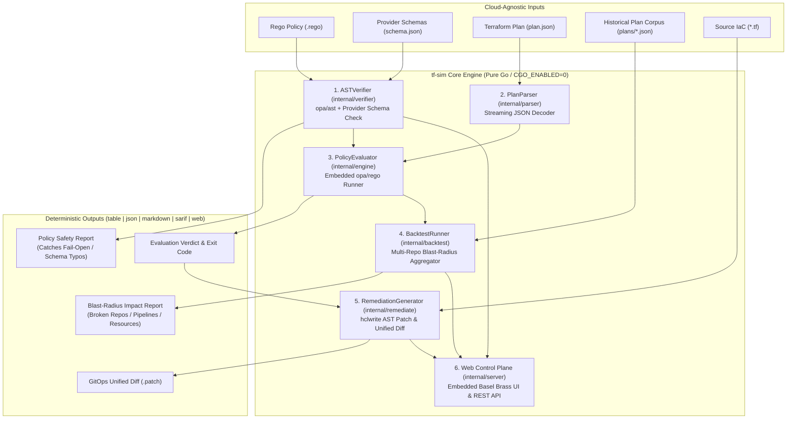

# `tf-sim`

[](https://github.com/justr00t/tf-sim/actions/workflows/ci.yml)
[](./LICENSE)
[-00ADD8?logo=go)](./go.mod)
[](#cloud-agnostic-by-design)

**Cloud-agnostic Terraform & OpenTofu policy verification, historical blast-radius simulation, surgical HCL auto-remediation engine, and local-first web control plane in pure Go.**

---

## Why `tf-sim`?

Platform and security engineering teams suffer from **"Audit-to-Enforce Paralysis."** Writing an Open Policy Agent (OPA) Rego guardrail takes 15 minutes—flipping that guardrail from passive `audit` mode to active `deny` mode across hundreds of CI/CD pipelines takes months because of three risks:

1. **Silent "Fail-Open" Policies:** A single typo in a Rego attribute path (e.g., `rc.change.after.https_only_enabled` instead of `https_traffic_only_enabled`) causes OPA to evaluate `undefined` and silently pass non-compliant infrastructure.
2. **Unpredictable "Fail-Closed" Outages:** Enforcing a new guardrail without knowing which active repositories and deployment pipelines violate it causes immediate CI/CD blockages across engineering teams.
3. **Manual Remediation Toil:** Security teams flag violations, leaving application engineers to manually hunt down `.tf` files and write compensating HCL changes across dozens of repositories.

### Policy Lifecycle & Utility Commands

| Command | Stage | What It Does |
| :--- | :--- | :--- |
| **`tf-sim verify`** | **Author & Prove** | Inspects the Rego v1 AST (`opa/v1/ast`) across one or more `--policy` files, cross-references every resource type, nested attribute reference, and `remediation.attribute_path` target against `terraform providers schema -json`, and verifies the policy against `--pass-fixtures` and `--fail-fixtures` plan snapshots to prevent silent fail-open bugs. |
| **`tf-sim backtest`** | **Simulate Blast Radius** | Evaluates candidate policies concurrently across a historical corpus of `terraform plan -json` snapshots—answering in milliseconds which exact repos, plans, and cloud resources would break if enforced today. |
| **`tf-sim eval`** | **Enforce in CI/CD** | Streams single `terraform plan -json` artifacts in $O(1)$ bounded memory (skipping massive `prior_state` / `configuration` blobs) and evaluates `resource_changes` deterministically. |
| **`tf-sim remediate`** | **Auto-Patch HCL** | Maps policy violations back to source `.tf` files, mutates the HCL AST in-place via `hclwrite` (preserving comments and formatting), and generates unified Git diffs (`.patch`) for automated GitOps PRs. |
| **`tf-sim scrub`** | **Client-Side Plan Sanitizer** | Streams a `terraform show -json` plan (`--plan`, `--out`, `--redact-key`, `--pretty`), stripping `prior_state`/`configuration` bloat and redacting sensitive attributes before sharing or central evaluation. |
| **`tf-sim packs`** | **Starter Policy Packs** | Lists bundled multi-cloud starter policy packs (`aws`, `azure`, `gcp`) usable via `--pack` across `verify`, `backtest`, `eval`, and `remediate`. |
| **`tf-sim version`** | **Build Metadata** | Prints `tf-sim` release version, Git commit, build timestamp, Go version, and OS/architecture platform (`--format table\|json`, or `--version` / `-v`). |
| **`tf-sim serve` / `ui`** | **Interactive Web Workbench** | Launches a zero-dependency (`//go:embed`) local-first web control plane (`http://127.0.0.1:8080`) for interactive multi-repo blast-radius inspection, browser file uploads (`plan.json`, `.rego`, `schema.json`, `.tf`), live Rego AST & schema verification, and surgical HCL patch review. |

---

## Architecture Overview



---

## Installation & Build

`tf-sim` is distributed as a zero-dependency static binary (`CGO_ENABLED=0`) for `linux`, `darwin`, and `windows` (`amd64` and `arm64`).

### Homebrew (macOS & Linux)

```bash
brew install --cask justr00t/tap/tf-sim
tf-sim version
```

### Pre-Built Static Binary with SHA256 Verification (Linux / macOS / CI)

Every GitHub Release publishes `tf-sim_<version>_<os>_<arch>.tar.gz` (and `.zip` for Windows) alongside a signed-format `checksums.txt` manifest:

```bash
VERSION="0.1.0"
OS="linux"   # linux | darwin
ARCH="amd64" # amd64 | arm64
curl -fsSLO "https://github.com/justr00t/tf-sim/releases/download/v${VERSION}/tf-sim_${VERSION}_${OS}_${ARCH}.tar.gz"
curl -fsSLO "https://github.com/justr00t/tf-sim/releases/download/v${VERSION}/checksums.txt"
grep -F "  tf-sim_${VERSION}_${OS}_${ARCH}.tar.gz" checksums.txt > expected.sha256 && sha256sum -c expected.sha256
tar -xzf "tf-sim_${VERSION}_${OS}_${ARCH}.tar.gz" tf-sim
sudo install -m 0755 tf-sim /usr/local/bin/tf-sim
```

> **macOS note:** On macOS without GNU `sha256sum`, replace `sha256sum -c expected.sha256` with `shasum -a 256 -c expected.sha256`. Pre-built Windows archives are published as `tf-sim_${VERSION}_windows_${ARCH}.zip`.

### Build from Source (`CGO_ENABLED=0`)

```bash
git clone https://github.com/justr00t/tf-sim.git
cd tf-sim

# Build static binary
CGO_ENABLED=0 go build -o tf-sim ./cmd/tf-sim
```

---

## 60-Second Quickstart (No Cloud Credentials Required)

This repository includes multi-cloud fixtures (`AWS`, `Azure`, and `GCP`) in [`testdata/`](./testdata) so you can test the entire lifecycle immediately:

### 1. Catch a Silent "Fail-Open" Policy Bug (`verify`)
[`testdata/policies/broken_fail_open.rego`](./testdata/policies/broken_fail_open.rego) contains a realistic attribute typo (`https_only_enabled` instead of `https_traffic_only_enabled` on `azurerm_storage_account`). Standard OPA compilation passes it; `tf-sim verify` catches it against the provider schema:

```bash
./tf-sim verify \
  --policy testdata/policies/broken_fail_open.rego \
  --schema testdata/schemas/multicloud_schema.json
```
*(Exits with code `1` and pinpoints the exact line and invalid schema attribute path.)*

Now verify the valid multi-cloud storage encryption policy (and assert that non-compliant fixtures fail evaluation via `--fail-fixtures`; use `--pass-fixtures` for compliant fixtures):
```bash
./tf-sim verify \
  --policy testdata/policies/storage_encryption.rego \
  --schema testdata/schemas/multicloud_schema.json \
  --fail-fixtures testdata/plans
```
*(Exits with code `0` — `VALID`.)*

### 2. Simulate Cross-Repo Blast Radius (`backtest`)
See what would break across your organization's AWS, Azure, and GCP repositories before enabling enforcement:

```bash
./tf-sim backtest \
  --policy testdata/policies/storage_encryption.rego \
  --plans-dir testdata/plans \
  --format table
```

### 3. Evaluate a Single Plan for PR Comments (`eval`)
```bash
./tf-sim eval \
  --policy testdata/policies/storage_encryption.rego \
  --plan testdata/plans/repo_payments_aws.json \
  --format markdown

# Or emit SARIF v2.1.0 for GitHub Code Scanning / SAST dashboards:
./tf-sim eval \
  --policy testdata/policies/storage_encryption.rego \
  --plan testdata/plans/repo_payments_aws.json \
  --format sarif
```

### 4. Generate Surgical HCL Auto-Remediation Diffs (`remediate`)
Generate a unified Git diff (or pass `--write` to update `.tf` files in-place while preserving comments):

```bash
./tf-sim remediate \
  --policy testdata/policies/storage_encryption.rego \
  --plan testdata/plans/repo_payments_aws.json \
  --tf-dir testdata/repos/payments-aws \
  --format markdown
```

### 5. Launch the Local-First Web Control Plane (`serve` / `ui`)
Start the embedded web workbench on `http://127.0.0.1:8080` to inspect the multi-repo blast-radius ledger, upload your own `plan.json` / `.rego` / `.tf` files directly from the browser (`+ Load / Upload Files`), live-edit Rego policies with real-time schema verification, and preview or export `.patch` files:

```bash
./tf-sim serve
# Or pass --allow-write to permit Stage C "Apply Surgical Patch" to write directly to workspace .tf files:
./tf-sim serve --addr 127.0.0.1:8080 --allow-write
```

---

## Using `tf-sim` with Real Terraform / OpenTofu Projects

`tf-sim` works out of the box with any Terraform or OpenTofu provider (`hashicorp/aws`, `hashicorp/azurerm`, `hashicorp/google`, `hashicorp/kubernetes`, Datadog, Cloudflare, or custom providers):

```bash
# 1. Export your provider schemas once per provider version update
terraform providers schema -json > schema.json

# 2. Export a plan as JSON in CI/CD
terraform plan -out=tfplan
terraform show -json tfplan > plan.json

# 3. Verify policy safety, evaluate the plan, and generate HCL remediation diffs
tf-sim verify --policy policy.rego --schema schema.json
tf-sim eval --policy policy.rego --plan plan.json --format markdown
tf-sim remediate --policy policy.rego --plan plan.json --tf-dir . --format markdown
```

---

## CI/CD Integrations (GitHub Actions, GitLab CI, Atlantis)

### 1. Official GitHub Action (`justr00t/tf-sim`)

Drop `.github/workflows/tf-sim.yml` into any Terraform or OpenTofu repository to install the SHA256-verified `tf-sim` release binary, verify policies, evaluate `plan.json`, post a sticky PR comment with a collapsible surgical HCL remediation diff (`<details>`), and upload SARIF v2.1.0 findings to GitHub Code Scanning:

```yaml
name: tf-sim Policy Gate

on:
  pull_request:
    branches: [main]

permissions:
  contents: read
  pull-requests: write
  security-events: write

jobs:
  tf-sim:
    runs-on: ubuntu-latest
    steps:
      - name: Checkout repository
        uses: actions/checkout@v7

      - name: Setup Terraform
        uses: hashicorp/setup-terraform@v3
        with:
          terraform_wrapper: false

      - name: Generate Terraform Plan JSON
        run: |
          terraform init -backend=false
          terraform plan -out=tfplan
          terraform show -json tfplan > plan.json

      - name: Run tf-sim Policy Engine
        uses: justr00t/tf-sim@v0.1.0
        with:
          version: "v0.1.0"
          pack: "all"
          policy: "./policies"
          plan: "plan.json"
          tf-dir: "."
          remediate: "true"
          comment-pr: "true"
          upload-sarif: "true"
          mode: "enforce"
```

#### Progressive Rollout Modes (`audit` → `warn` → `enforce`)

Adopt `tf-sim` across existing repositories without blocking engineering teams on day one:

| Mode | Policy Violation (`ExitViolation` = `1`) | Operational / CLI Error (`ExitError` = `2`) | Recommended Stage |
| :--- | :--- | :--- | :--- |
| **`audit`** | Exits `0`; posts sticky PR comment + optional SARIF upload silently. | **Exits `2`** (fails job immediately). | Week 1: Shadow baseline across all repos. |
| **`warn`** | Exits `0`; emits GitHub `::warning::` annotations + PR comment + SARIF. | **Exits `2`** (fails job immediately). | Week 2: Surface visible PR warnings while teams apply auto-remediation diffs. |
| **`enforce`** | Exits `1` (blocks merge) after posting PR comment + SARIF upload. | **Exits `2`** (fails job immediately). | Production: Full guardrail enforcement. |

#### Action Inputs & Outputs Reference

- **Inputs**: `version` (default `'latest'`), `binary-path`, `mode` (`'enforce'`), `policy`, `pack`, `plan`, `schema`, `run-verify` (`'true'`), `pass-fixtures`, `fail-fixtures`, `remediate` (`'true'`), `tf-dir` (`'.'`), `repo-name`, `working-directory` (`'.'`), `comment-pr` (`'true'`), `comment-key` (`'default'`), `upload-sarif` (`'false'`), `sarif-category` (`'tf-sim'`), `github-token` (`'${{ github.token }}'`).
- **Outputs**: `verify-exit-code`, `eval-exit-code`, `exit-code`, `violations-count`, `patches-count`, `sarif-file`, `markdown-file`.

---

### 2. GitLab CI (`.gitlab-ci.yml`)

Add this `tf-sim-policy` job after your `terraform plan` stage (assuming `plan.json` is passed via `artifacts:` or generated in-job). It verifies the release archive checksum, scrubs sensitive state/config blocks prior to evaluation, runs `verify`, `eval`, and read-only `remediate`, and enforces `TFSIM_MODE` (`audit | warn | enforce`) while preserving operational `ExitError` (`2`):

```yaml
tf-sim-policy:
  stage: test
  image: alpine:3.20
  variables:
    TFSIM_VERSION: "0.1.0"
    TFSIM_MODE: "enforce" # audit | warn | enforce
  before_script:
    - apk add --no-cache curl tar coreutils
    - |
      curl -fsSLO "https://github.com/justr00t/tf-sim/releases/download/v${TFSIM_VERSION}/tf-sim_${TFSIM_VERSION}_linux_amd64.tar.gz"
      curl -fsSLO "https://github.com/justr00t/tf-sim/releases/download/v${TFSIM_VERSION}/checksums.txt"
      grep -F "  tf-sim_${TFSIM_VERSION}_linux_amd64.tar.gz" checksums.txt > expected.sha256 && sha256sum -c expected.sha256
      tar -xzf "tf-sim_${TFSIM_VERSION}_linux_amd64.tar.gz" tf-sim
      install -m 0755 tf-sim /usr/local/bin/tf-sim
      rm -f "tf-sim_${TFSIM_VERSION}_linux_amd64.tar.gz" checksums.txt expected.sha256
  script:
    - |
      set -eu

      tf-sim scrub --plan plan.json --out plan.scrubbed.json

      VERIFY_RC=0
      tf-sim verify --pack all --policy ./policies --format markdown > tf-sim-report.md || VERIFY_RC=$?
      if [ "$VERIFY_RC" -ne 0 ] && [ "$VERIFY_RC" -ne 1 ]; then
        exit "$VERIFY_RC"
      fi

      EVAL_RC=0
      tf-sim eval --pack all --policy ./policies --plan plan.scrubbed.json --format markdown >> tf-sim-report.md || EVAL_RC=$?
      if [ "$EVAL_RC" -ne 0 ] && [ "$EVAL_RC" -ne 1 ]; then
        exit "$EVAL_RC"
      fi

      SARIF_RC=0
      tf-sim eval --pack all --policy ./policies --plan plan.scrubbed.json --format sarif > tf-sim.sarif || SARIF_RC=$?
      if [ "$SARIF_RC" -ne 0 ] && [ "$SARIF_RC" -ne 1 ]; then
        exit "$SARIF_RC"
      fi

      if [ "$EVAL_RC" -eq 1 ]; then
        tf-sim remediate --pack all --policy ./policies --plan plan.scrubbed.json --tf-dir . --format markdown >> tf-sim-report.md
      fi

      cat tf-sim-report.md

      if [ "$VERIFY_RC" -eq 1 ] || [ "$EVAL_RC" -eq 1 ]; then
        case "$TFSIM_MODE" in
          audit)
            exit 0
            ;;
          warn)
            echo "WARNING: tf-sim detected policy violations (mode=warn)." >&2
            exit 0
            ;;
          enforce)
            exit 1
            ;;
          *)
            echo "ERROR: invalid TFSIM_MODE='$TFSIM_MODE' (expected audit|warn|enforce)" >&2
            exit 2
            ;;
        esac
      fi
  artifacts:
    when: always
    paths:
      - tf-sim-report.md
      - tf-sim.sarif
```

---

### 3. Atlantis (`Dockerfile` + Server-Side `repos.yaml`)

#### Part A: Custom Atlantis Image (`Dockerfile`)

Bake the SHA256-verified `tf-sim` static binary into your Atlantis server container:

```dockerfile
FROM ghcr.io/runatlantis/atlantis:latest

ARG TFSIM_VERSION=0.1.0
ARG TARGETARCH=amd64

RUN curl -fsSLO "https://github.com/justr00t/tf-sim/releases/download/v${TFSIM_VERSION}/tf-sim_${TFSIM_VERSION}_linux_${TARGETARCH}.tar.gz" \
    && curl -fsSLO "https://github.com/justr00t/tf-sim/releases/download/v${TFSIM_VERSION}/checksums.txt" \
    && grep -F "  tf-sim_${TFSIM_VERSION}_linux_${TARGETARCH}.tar.gz" checksums.txt > expected.sha256 \
    && sha256sum -c expected.sha256 \
    && tar -xzf "tf-sim_${TFSIM_VERSION}_linux_${TARGETARCH}.tar.gz" tf-sim \
    && install -m 0755 tf-sim /usr/local/bin/tf-sim \
    && rm -f "tf-sim_${TFSIM_VERSION}_linux_${TARGETARCH}.tar.gz" checksums.txt expected.sha256 \
    && tf-sim version
```

#### Part B: Server-Side `repos.yaml`

Configure a custom workflow where `plan` generates `$SHOWFILE` via `- show` and `policy_check` runs `tf-sim verify`, `tf-sim eval --plan "$SHOWFILE"`, and prints `tf-sim remediate --plan "$SHOWFILE" --tf-dir "." --format markdown` directly into the Atlantis PR comment whenever violations occur:

```yaml
repos:
  - id: /.*/
    workflow: tfsim
    apply_requirements: [approved, mergeable]

workflows:
  tfsim:
    plan:
      steps:
        - init
        - plan
        - show
    policy_check:
      steps:
        - run: |
            set -eu
            VERIFY_RC=0
            tf-sim verify --pack all --policy ./policies --format markdown || VERIFY_RC=$?
            if [ "$VERIFY_RC" -ne 0 ] && [ "$VERIFY_RC" -ne 1 ]; then
              exit "$VERIFY_RC"
            fi

            EVAL_RC=0
            tf-sim eval --pack all --policy ./policies --plan "$SHOWFILE" --format markdown || EVAL_RC=$?
            if [ "$EVAL_RC" -ne 0 ] && [ "$EVAL_RC" -ne 1 ]; then
              exit "$EVAL_RC"
            fi

            if [ "$EVAL_RC" -eq 1 ]; then
              tf-sim remediate --pack all --policy ./policies --plan "$SHOWFILE" --tf-dir "." --format markdown
            fi

            if [ "$VERIFY_RC" -eq 1 ] || [ "$EVAL_RC" -eq 1 ]; then
              exit 1
            fi
```

---

## Policy Contract & Remediation Metadata

Policies evaluated by `tf-sim` use standard Rego v1 syntax (`import rego.v1`) and emit structured `deny` or `violation` objects. Including an optional `remediation` block unlocks automatic HCL AST patching via `tf-sim remediate`:

```rego
package tfsim

import rego.v1

deny contains violation if {
    some rc in input.resource_changes
    rc.type == "azurerm_storage_account"
    rc.change.actions != ["delete"]
    rc.change.after.https_traffic_only_enabled == false

    violation := {
        "rule_id": "AZURE-STORAGE-HTTPS-001",
        "severity": "HIGH",
        "message": sprintf("Storage account %s must enforce HTTPS traffic only", [rc.address]),
        "resource_address": rc.address,
        "resource_type": rc.type,
        "resource_name": rc.name,
        "remediation": {
            "attribute_path": ["https_traffic_only_enabled"],
            "suggested_value": true,
            "description": "Set https_traffic_only_enabled = true"
        }
    }
}
```

---

## Deterministic CI/CD Exit Codes

| Exit Code | Constant | Meaning |
| :---: | :--- | :--- |
| `0` | `ExitOK` | Policy verified clean, plan passed evaluation, backtest had zero blocked plans, or remediation succeeded. |
| `1` | `ExitViolation` | Policy failed schema/AST verification (`verify`), plan violated policy (`eval`), or historical plans were blocked (`backtest`). |
| `2` | `ExitError` | CLI flag error, missing/unreadable input file, syntax failure, or runtime error. |

---

## Documentation & Architecture

For deep-dive specifications on the streaming JSON parser, Rego AST reference walker, worker pool concurrency, `hclwrite` surgical patcher, and local web control plane, see [`DESIGN.md`](./DESIGN.md).

## License

Licensed under the [Apache License, Version 2.0](./LICENSE).
