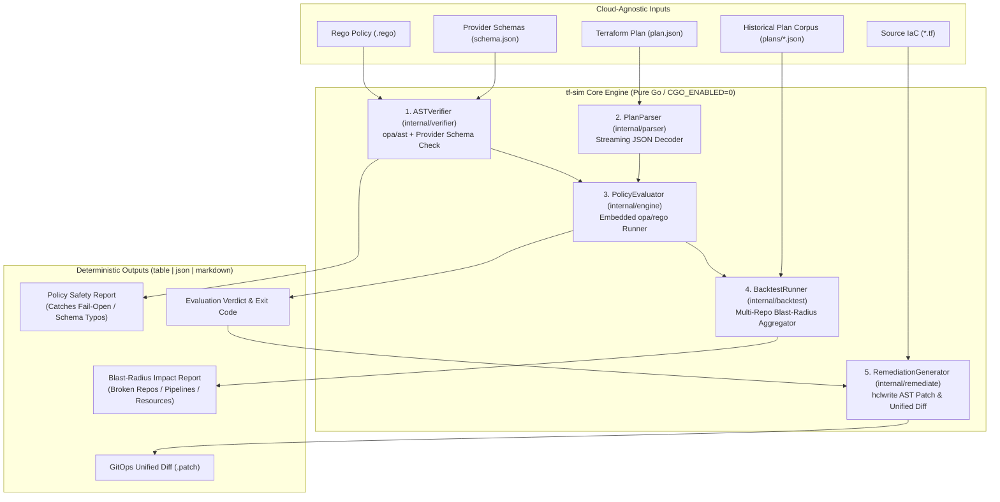

# `tf-sim`

[](https://github.com/justr00t/tf-sim/actions/workflows/ci.yml)
[](./LICENSE)
[-00ADD8?logo=go)](./go.mod)
[](#cloud-agnostic-by-design)

**Cloud-agnostic Terraform & OpenTofu policy verification, historical blast-radius simulation, and surgical HCL auto-remediation engine in pure Go.**

---

## Why `tf-sim`?

Platform and security engineering teams suffer from **"Audit-to-Enforce Paralysis."** Writing an Open Policy Agent (OPA) Rego guardrail takes 15 minutes—flipping that guardrail from passive `audit` mode to active `deny` mode across hundreds of CI/CD pipelines takes months because of three risks:

1. **Silent "Fail-Open" Policies:** A single typo in a Rego attribute path (e.g., `rc.change.after.https_only_enabled` instead of `https_traffic_only_enabled`) causes OPA to evaluate `undefined` and silently pass non-compliant infrastructure.
2. **Unpredictable "Fail-Closed" Outages:** Enforcing a new guardrail without knowing which active repositories and deployment pipelines violate it causes immediate CI/CD blockages across engineering teams.
3. **Manual Remediation Toil:** Security teams flag violations, leaving application engineers to manually hunt down `.tf` files and write compensating HCL changes across dozens of repositories.

### Four Commands for the Full Policy Lifecycle

| Command | Stage | What It Does |
| :--- | :--- | :--- |
| **`tf-sim verify`** | **Author & Prove** | Inspects the Rego v1 AST (`opa/v1/ast`) and cross-references every resource type and nested attribute path against `terraform providers schema -json` to statically prevent silent fail-open typos. |
| **`tf-sim backtest`** | **Simulate Blast Radius** | Evaluates candidate policies concurrently across a historical corpus of `terraform plan -json` snapshots—answering in milliseconds which exact repos, plans, and cloud resources would break if enforced today. |
| **`tf-sim eval`** | **Enforce in CI/CD** | Streams single `terraform plan -json` artifacts in $O(1)$ bounded memory (skipping massive `prior_state` / `configuration` blobs) and evaluates `resource_changes` deterministically. |
| **`tf-sim remediate`** | **Auto-Patch HCL** | Maps policy violations back to source `.tf` files, mutates the HCL AST in-place via `hclwrite` (preserving comments and formatting), and generates unified Git diffs (`.patch`) for automated GitOps PRs. |

---

## Architecture Overview



---

## Installation & Build

`tf-sim` is written in 100% pure Go (`CGO_ENABLED=0`) with zero C dependencies.

```bash
git clone https://github.com/justr00t/tf-sim.git
cd tf-sim

# Build static binary
CGO_ENABLED=0 go build -o tf-sim ./cmd/tf-sim
```

---

## 60-Second Quickstart (No Cloud Credentials Required)

This repository includes multi-cloud fixtures (`AWS`, `Azure`, and `GCP`) in [`testdata/`](./testdata) so you can test the entire lifecycle immediately:

### 1. Catch a Silent "Fail-Open" Policy Bug (`verify`)
[`testdata/policies/broken_fail_open.rego`](./testdata/policies/broken_fail_open.rego) contains a realistic attribute typo (`https_only_enabled` instead of `https_traffic_only_enabled` on `azurerm_storage_account`). Standard OPA compilation passes it; `tf-sim verify` catches it against the provider schema:

```bash
./tf-sim verify \
  --policy testdata/policies/broken_fail_open.rego \
  --schema testdata/schemas/multicloud_schema.json
```
*(Exits with code `1` and pinpoints the exact line and invalid schema attribute path.)*

Now verify the valid multi-cloud storage encryption policy:
```bash
./tf-sim verify \
  --policy testdata/policies/storage_encryption.rego \
  --schema testdata/schemas/multicloud_schema.json
```
*(Exits with code `0` — `VALID`.)*

### 2. Simulate Cross-Repo Blast Radius (`backtest`)
See what would break across your organization's AWS, Azure, and GCP repositories before enabling enforcement:

```bash
./tf-sim backtest \
  --policy testdata/policies/storage_encryption.rego \
  --plans-dir testdata/plans \
  --format table
```

### 3. Evaluate a Single Plan for PR Comments (`eval`)
```bash
./tf-sim eval \
  --policy testdata/policies/storage_encryption.rego \
  --plan testdata/plans/repo_payments_aws.json \
  --format markdown
```

### 4. Generate Surgical HCL Auto-Remediation Diffs (`remediate`)
Generate a unified Git diff (or pass `--write` to update `.tf` files in-place while preserving comments):

```bash
./tf-sim remediate \
  --policy testdata/policies/storage_encryption.rego \
  --plan testdata/plans/repo_payments_aws.json \
  --tf-dir testdata/repos/payments-aws \
  --format markdown
```

---

## Using `tf-sim` with Real Terraform / OpenTofu Projects

`tf-sim` works out of the box with any Terraform or OpenTofu provider (`hashicorp/aws`, `hashicorp/azurerm`, `hashicorp/google`, `hashicorp/kubernetes`, Datadog, Cloudflare, or custom providers):

```bash
# 1. Export your provider schemas once per provider version update
terraform providers schema -json > schema.json

# 2. Export a plan as JSON in CI/CD
terraform plan -out=tfplan
terraform show -json tfplan > plan.json

# 3. Verify policy safety, evaluate the plan, and generate HCL remediation diffs
tf-sim verify --policy policy.rego --schema schema.json
tf-sim eval --policy policy.rego --plan plan.json --format markdown
tf-sim remediate --policy policy.rego --plan plan.json --tf-dir . --format markdown
```

---

## Policy Contract & Remediation Metadata

Policies evaluated by `tf-sim` use standard Rego v1 syntax (`import rego.v1`) and emit structured `deny` or `violation` objects. Including an optional `remediation` block unlocks automatic HCL AST patching via `tf-sim remediate`:

```rego
package tfsim

import rego.v1

deny contains violation if {
    some rc in input.resource_changes
    rc.type == "azurerm_storage_account"
    not "delete" in rc.change.actions
    rc.change.after.https_traffic_only_enabled == false

    violation := {
        "rule_id": "AZURE-STORAGE-HTTPS-001",
        "severity": "HIGH",
        "message": sprintf("Storage account %s must enforce HTTPS traffic only", [rc.address]),
        "resource_address": rc.address,
        "resource_type": rc.type,
        "resource_name": rc.name,
        "remediation": {
            "attribute_path": ["https_traffic_only_enabled"],
            "suggested_value": true,
            "description": "Set https_traffic_only_enabled = true"
        }
    }
}
```

---

## Deterministic CI/CD Exit Codes

| Exit Code | Constant | Meaning |
| :---: | :--- | :--- |
| `0` | `ExitOK` | Policy verified clean, plan passed evaluation, backtest had zero blocked plans, or remediation succeeded. |
| `1` | `ExitViolation` | Policy failed schema/AST verification (`verify`), plan violated policy (`eval`), or historical plans were blocked (`backtest`). |
| `2` | `ExitError` | CLI flag error, missing/unreadable input file, syntax failure, or runtime error. |

---

## Documentation & Architecture

For deep-dive specifications on the streaming JSON parser, Rego AST reference walker, worker pool concurrency, and `hclwrite` surgical patcher, see [`DESIGN.md`](./DESIGN.md).

## License

Licensed under the [Apache License, Version 2.0](./LICENSE).
